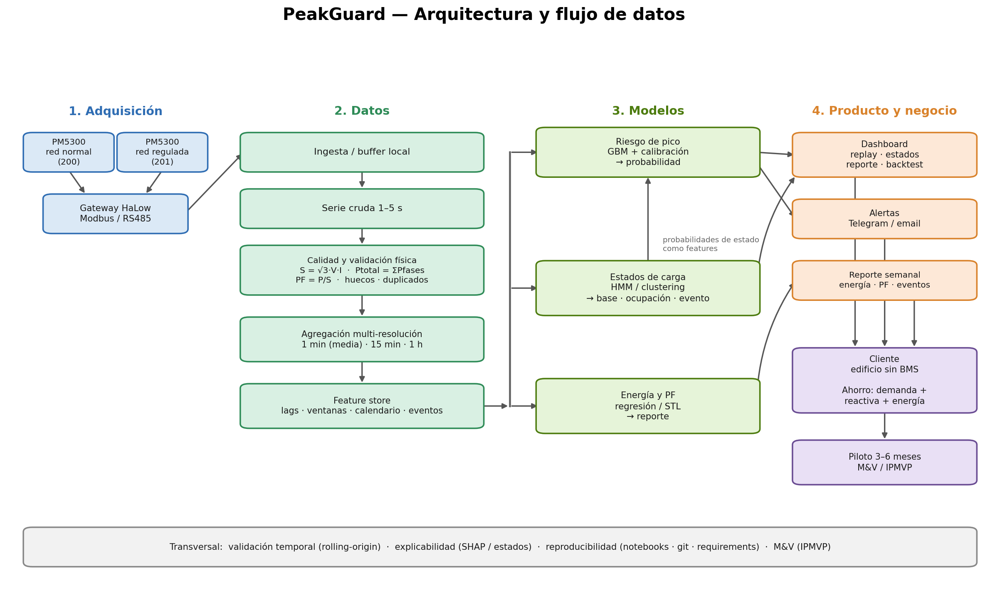
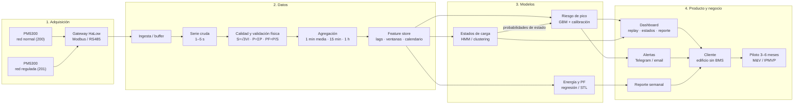
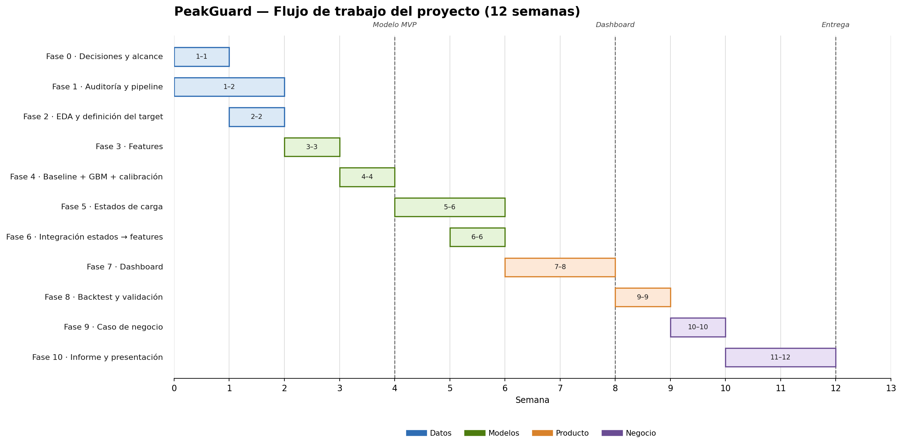
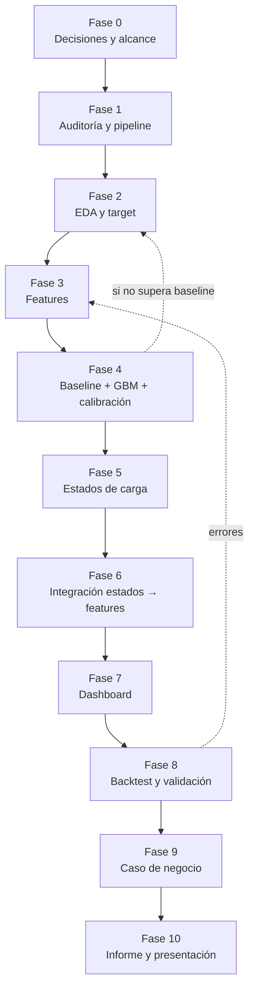

# PeakGuard — Diagramas del proyecto

Este documento resume **qué hace el sistema** (arquitectura y flujo de datos) y **cómo se construye** (flujo de trabajo en 12 semanas).

Archivos generados:

- `diagrama_arquitectura.png` — diagrama de bloques del sistema.
- `diagrama_flujo_trabajo.png` — cronograma de fases.
- `make_diagrams.py` — script que regenera ambos PNG.

---

## 1. Arquitectura y flujo de datos



### Lectura del diagrama

El sistema se organiza en cuatro capas y una franja transversal:

| Capa | Bloques | Qué resuelve |
|---|---|---|
| **1. Adquisición** | PM5300 red normal (200), PM5300 red regulada (201), gateway HaLow | Lleva las mediciones del tablero al sistema sin depender de Wi-Fi industrial |
| **2. Datos** | Ingesta, serie cruda 1–5 s, calidad y validación física, agregación multi-resolución, feature store | Convierte el crudo en datos confiables y features listos para modelar |
| **3. Modelos** | Riesgo de pico (GBM + calibración), estados de carga (HMM/clustering), energía y PF | Predice, explica y reporta |
| **4. Producto y negocio** | Dashboard, alertas, reporte semanal, cliente, piloto | Entrega el valor y lo convierte en servicio |
| **Transversal** | Validación temporal, explicabilidad, reproducibilidad, M&V | Garantiza que el resultado sea creíble y vendible |

**Flujo principal:** medidor → HaLow → ingesta → serie cruda → validación → agregación → features → modelos → dashboard/alertas/reporte → cliente → piloto.

**Lazo de retroalimentación:** el modelo de estados de carga entrega probabilidades de estado como features del clasificador de picos; el backtest retroalimenta features y umbrales.

### Versión editable (Mermaid)



---

## 2. Flujo de trabajo



### Fases y entregables

| Fase | Semanas | Entregable |
|---|---|---|
| 0. Decisiones y alcance | 1 | Medidores confirmados, tarifa, umbral, horizonte |
| 1. Auditoría y pipeline | 1–2 | Serie de 1 min como media de 10 s, huecos, Parquet |
| 2. EDA y target | 2 | Distribuciones, tasa de positivos, definición de `P > umbral` |
| 3. Features | 3 | Lags, ventanas, calendario, eventos |
| 4. Baseline + GBM + calibración | 4 | Modelo de riesgo con PR-AUC/Brier y calibración |
| 5. Estados de carga | 5–6 | HMM/clustering interpretado y validado |
| 6. Integración | 6 | Probabilidades de estado como features |
| 7. Dashboard | 7–8 | Replay, estados, reporte, backtest |
| 8. Backtest y validación | 9 | Métricas finales y análisis de errores |
| 9. Caso de negocio | 10 | Fórmula de ahorro con tarifa real |
| 10. Informe y presentación | 11–12 | Documento y pitch |

**Hitos:** modelo MVP al final de la semana 4, dashboard al final de la semana 8, entrega al final de la semana 12.

### Versión editable (Mermaid)



---

## 3. Cómo se conecta con el documento del proyecto

- La capa **Datos** implementa la sección 5 de `PEAKGUARD.md`.
- La capa **Modelos** implementa la sección 6.
- La capa **Producto y negocio** implementa las secciones 8 y 10.
- La franja **Transversal** implementa la sección 9 (validación y criterios de aceptación).

## 4. Regenerar los diagramas

```powershell
cd repo\Proyecto\docs
python make_diagrams.py
```

Requiere `matplotlib`. Los PNG se guardan en esta misma carpeta.
